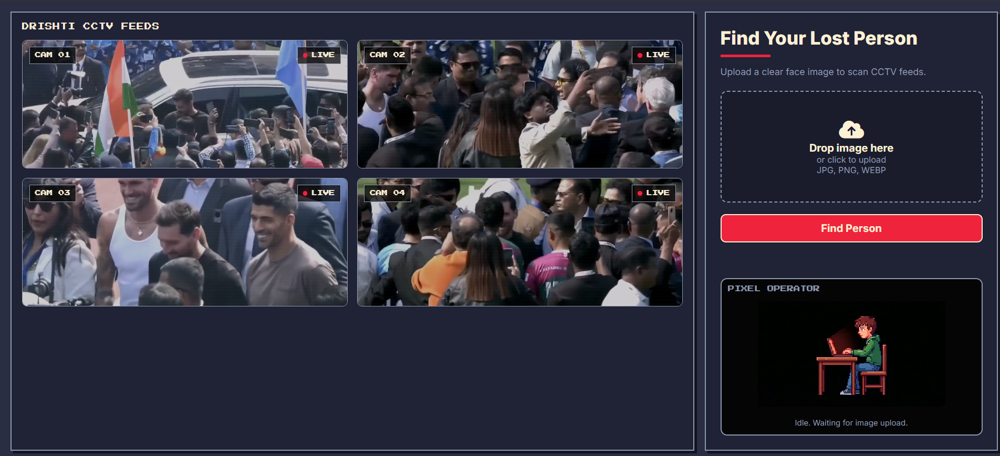
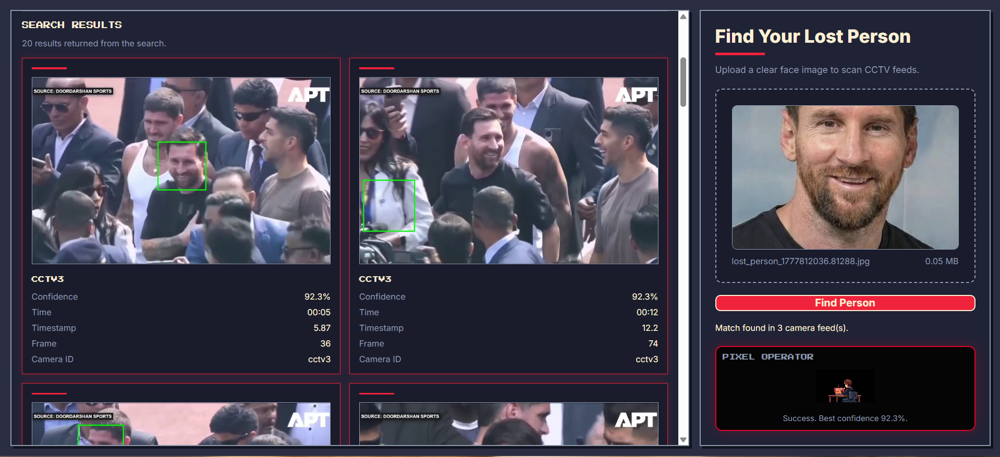
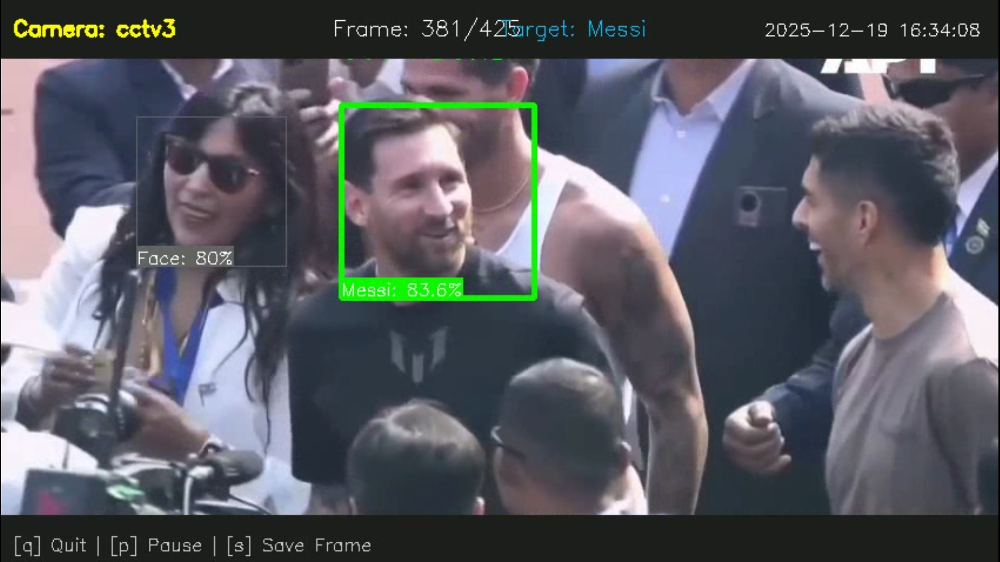
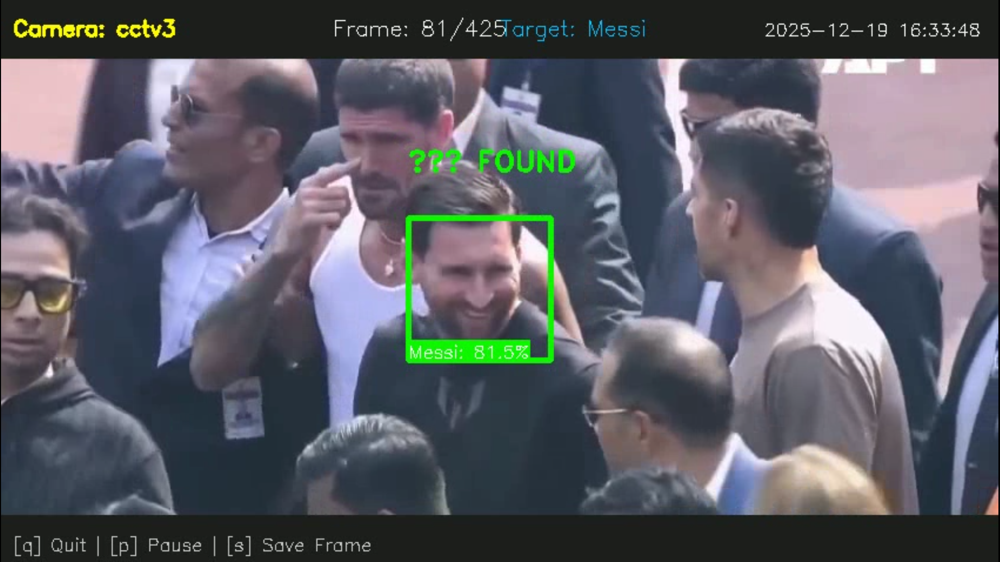
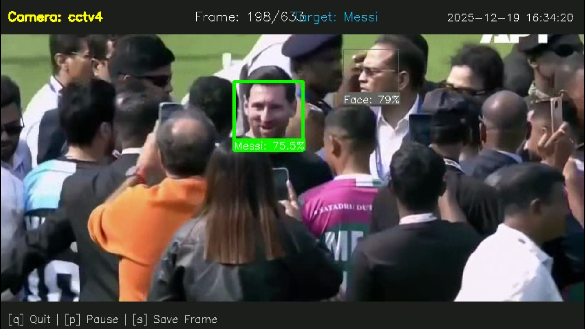
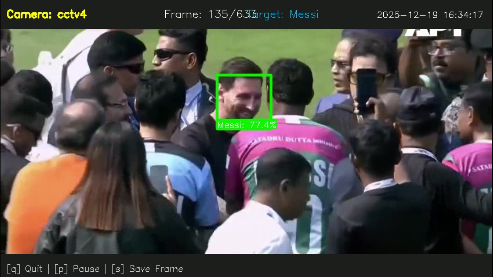

# DRISHTI - Lost Person Detection System

Find a lost person in CCTV footage from a single photo. Drishti scans every video in the `CCTVS/` folder with a modern face-recognition pipeline and tells you **which camera** saw the person, **when**, and **how confident** the match is and honestly says **"No Reliable Match"** when the evidence is weak, instead of showing the wrong person.

## Tech Stack

| Layer | Technology |
|---|---|
| Face detection + recognition | **InsightFace `buffalo_l`** (SCRFD detector + ArcFace embeddings) on **ONNX Runtime** |
| Video processing | **OpenCV** |
| Backend API | **FastAPI** + **Uvicorn** (Python) |
| Frontend | Single-page HTML/CSS/vanilla JS (served by the backend) |
| Fallback engine | Haar Cascade + ResNet18 (PyTorch) — legacy, optional |

## Features

- 🔍 **Modern face recognition** - InsightFace ArcFace embeddings with landmark-aligned faces
- 🛡️ **Open-set matching** - returns *Strong Match / Possible Match / No Reliable Match* (never a fake "98% confidence")
- 🎯 **Multi-frame confirmation** - a person must match across several frames (IoU tracking) before being reported
- 📹 **Per-camera results** - if the person appears in 4 feeds, you get a result card for each camera
- 🗂️ **Local CCTV feeds** - drop video files into `CCTVS/` and they automatically appear in the UI and get searched
- 🧹 **Quality gating** - blurry / tiny / badly-lit face crops are rejected before matching (with per-camera debug counts)
- 🎬 **Snapshots** - best frame + face crop saved for every confirmed match

**Pipeline:** `CCTV frames → SCRFD face detection → quality gate → ArcFace embedding → cosine similarity vs target → IoU track aggregation → open-set decision (per camera)`

## Project Structure
```
DRISHTI/
├── src/
│   ├── backend/
│   │   ├── app.py                   # FastAPI app & API routes
│   │   ├── search_service.py        # Search entry point (engine router + RTSP helpers)
│   │   ├── routes_camera.py         # Live-camera API (placeholder, future)
│   │   ├── vision/                  # Face recognition pipeline
│   │   │   ├── config.py            # ALL thresholds & tuning (env-overridable)
│   │   │   ├── insightface_engine.py# InsightFace buffalo_l (loads once)
│   │   │   ├── quality.py           # face quality gate
│   │   │   ├── matcher.py           # cosine similarity + open-set decision
│   │   │   ├── tracker.py           # IoU tracking, per-track aggregation
│   │   │   ├── pipeline.py          # search orchestration, per-camera results
│   │   │   ├── detector.py / recognizer.py  # backend seams (SCRFD/AdaFace-ready)
│   │   │   └── legacy_engine.py     # old Haar+ResNet18 fallback
│   │   └── camera/                  # rolling-buffer skeleton (future live feeds)
│   ├── config/settings.py           # server & directory settings
│   └── utils/
├── Frontend/                        # Web UI
│   ├── index.html
│   └── assets/
├── CCTVS/                           # ← put your CCTV videos here
├── data/
│   ├── uploads/                     # uploaded target photos
│   └── results/                     # match snapshots & crops
├── docs/
├── run.py                           # application entry point
└── requirements.txt
```


## System Interface

### Main UI Views

<div align="center">

| CCTV Interface | Search Results |
|---|---|
|  |  |

</div>

### System Process Flow

<div align="center">

|  |  |
|---|---|
|  |  |
|  |  |

</div>

## Installation & Setup

### Prerequisites
- Python 3.10+
- pip
- ~1 GB free disk space (the InsightFace model pack, ~330 MB, downloads automatically on first search)

### Steps

1. **Clone / download the project**
   ```bash
   cd DRISHTI
   ```

2. **(Recommended) Create a virtual environment**
   ```bash
   python -m venv venv
   venv\Scripts\activate        # Windows
   source venv/bin/activate     # Linux/macOS
   ```

3. **Install dependencies**
   ```bash
   pip install -r requirements.txt
   ```

4. **Add CCTV videos**

   Put video files in the `CCTVS/` folder. Supported: `.mp4 .mov .avi .mkv .webm`

5. **Run**
   ```bash
   python run.py
   ```
   Open `http://localhost:8000` — the CCTV feeds appear automatically, one card per video.

> First search downloads the `buffalo_l` model to `~/.insightface/models` (internet needed once). The model loads a single time and is reused.

## Usage

1. Drop CCTV clips into `CCTVS/` (they show up as live feed cards in the UI).
2. Upload a clear photo of the lost person.
3. Click **Find Person**.
4. Results appear **per camera**: match strength (Strong/Possible), similarity score, confirmed frames, time range, and a snapshot. Cameras with a match are highlighted in the grid.
5. If the person can't be verified anywhere, the UI shows **"No Reliable Match Found"**.

## API Endpoints

| Endpoint | Description |
|---|---|
| `POST /api/search` | Upload a photo (`file`), search all CCTVS videos. Returns results directly. |
| `GET /api/search-results/{search_id}` | Re-fetch a previous search result |
| `GET /api/cameras` | List local CCTV feeds (`id`, `name`, `filename`, `video_url`) |
| `GET /api/cctv-video/{filename}` | Stream a video from `CCTVS/` (path-traversal safe) |
| `GET /api/snapshot/{filename}` | Match snapshot / face crop images |
| `GET /api/health` | Health check |
| `POST /api/camera/connect` etc. | Live-camera module (placeholder, not implemented yet) |

### `POST /api/search` response (shape)
```json
{
  "success": true,
  "search_id": "search_...",
  "results": {
    "decision": "match_found",
    "matches": [
      {
        "camera": "cctv1", "camera_name": "CCTV 1",
        "decision": "strong_match",
        "best_similarity": 0.63, "avg_similarity": 0.58, "matched_frames": 4,
        "timestamp_start": "00:00:02", "timestamp_end": "00:00:07",
        "best_frame": "/api/snapshot/...", "best_crop": "/api/snapshot/..."
      }
    ],
    "matches_by_camera": { "cctv1": ["..."] },
    "near_misses": ["cameras that were close to the threshold (debug)"],
    "per_camera_debug": { "cctv1": { "frames_processed": 41, "faces_detected": 502, "valid_faces": 357, "rejected": "...", "best_similarity_seen": 0.63 } }
  }
}
```
When nothing qualifies: `"decision": "no_reliable_match"` with an empty `matches` list.

## Configuration & Tuning

All recognition tuning lives in **`src/backend/vision/config.py`**. Every value can also be overridden with an environment variable (`DRISHTI_<NAME>`), no code edit needed.

| Setting | Default | Meaning |
|---|---|---|
| `MATCH_THRESHOLD` | `0.55` | Cosine floor for a **Strong Match** |
| `POSSIBLE_MATCH_THRESHOLD` | `0.45` | Floor for a **Possible Match** |
| `MIN_MATCH_FRAMES` | `2` | Frames a track must match before it counts |
| `MIN_FACE_SIZE` | `24` px | Smaller detected faces are ignored |
| `FRAME_SKIP` | `3` | Process every Nth frame (higher = faster, less recall) |
| `DET_SIZE` | `640` | Detector input size (`480`/`320` = much faster on CPU) |
| `RESULT_MODE` | `per_camera` | Best match from each camera (`global` = legacy top-N) |
| `MAX_RESULTS_PER_CAMERA` | `2` | Result cards allowed per camera |
| `RECOGNIZER_BACKEND` | `insightface` | `legacy` = old Haar+ResNet18 engine |

Examples:
```bash
# faster CPU demo
DRISHTI_DET_SIZE=480 DRISHTI_FRAME_SKIP=5 python run.py

# higher precision (fewer false positives, may miss distant faces)
DRISHTI_MATCH_THRESHOLD=0.60 python run.py
```

GPU: install `onnxruntime-gpu` and CUDA is used automatically (falls back to CPU).

## Match Decisions

| Decision | Meaning |
|---|---|
| **Strong Match** | Similarity ≥ 0.55 across multiple frames of the same track |
| **Possible Match** | Several frames above 0.45 — shown, but clearly weaker |
| **No Reliable Match** | Evidence too weak — by design, better than showing the wrong person |

Cosine similarity is shown as a score (e.g. `0.63`), never as a fake "confidence %".

## Troubleshooting

- **"No face detected in the uploaded photo"** — use a clearer, front-facing target photo.
- **Person missed** — try `DRISHTI_FRAME_SKIP=2` (denser sampling) or lower `DRISHTI_MATCH_THRESHOLD`; check `per_camera_debug` in the API response to see why faces were rejected.
- **Slow search** — CPU inference is the bottleneck: set `DRISHTI_DET_SIZE=480` (or `320`) and/or raise `DRISHTI_FRAME_SKIP`.
- **Feeds not showing** — confirm the files are in `CCTVS/` with a supported extension, then hard-refresh the browser.

## Limitations

- CPU-only search of a few short clips takes ~1–2 minutes (GPU is much faster).
- Accuracy depends on face size/visibility in the footage — distant or turned-away faces may be legitimately unmatchable.
- Live phone/IP-camera streaming is a planned module (API skeleton exists, not implemented yet).

## Credits

Built with:
- FastAPI
- InsightFace (ONNX Runtime)
- OpenCV
- Uvicorn

---

**Made By**: TeesMaarKhaCoders
